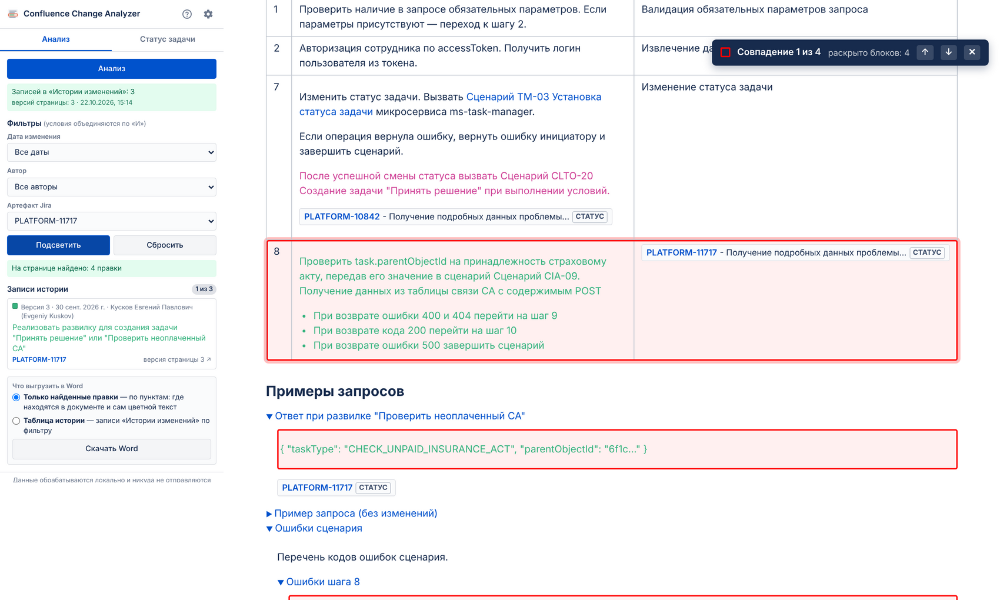
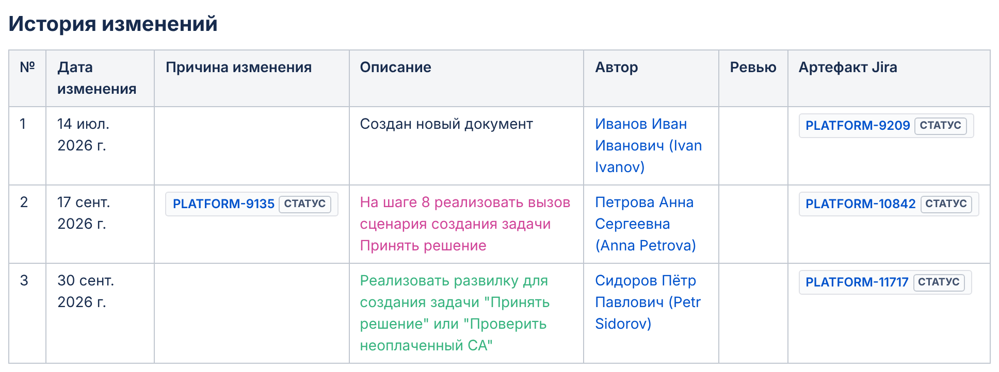
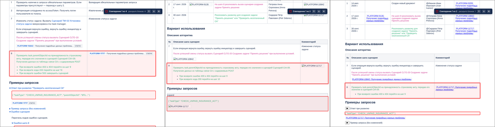
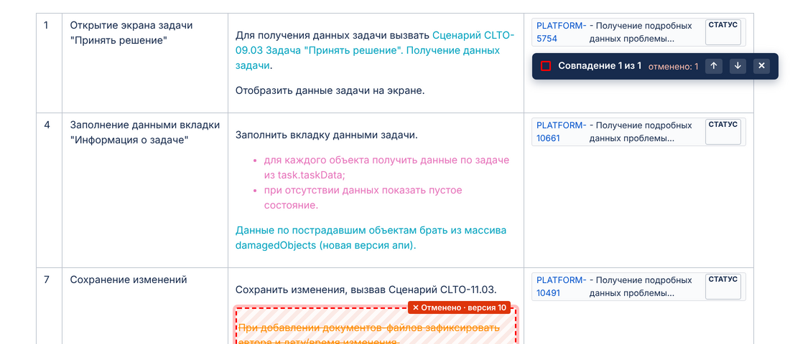
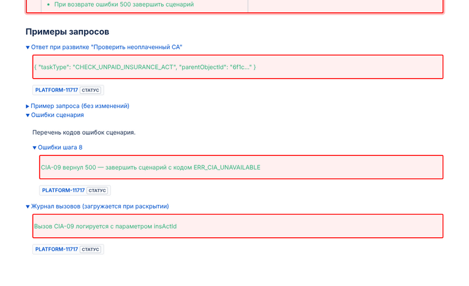
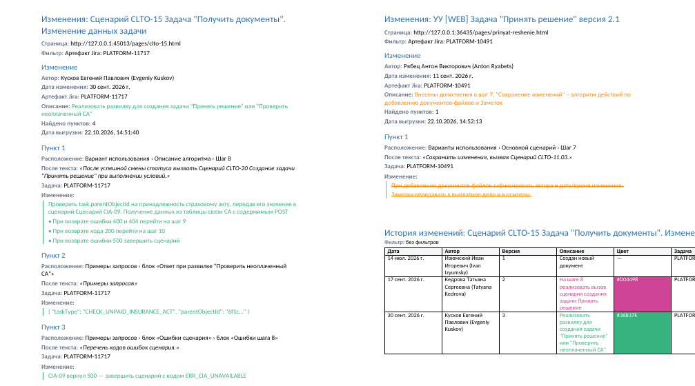
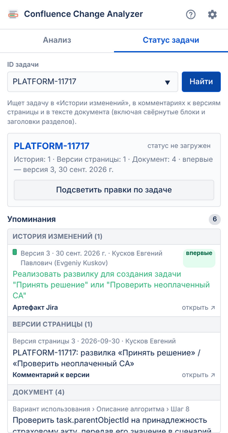
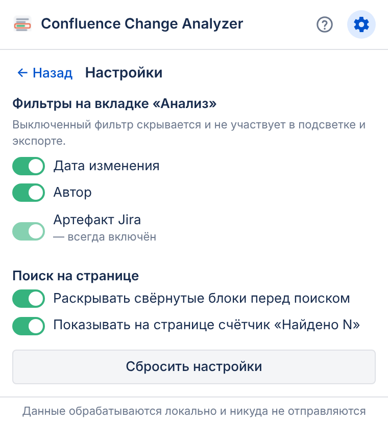

# Confluence Change Analyzer

Chrome-расширение (Manifest V3), которое помогает аналитикам и менеджерам разбираться в правках
документов Confluence: по задаче Jira, дате или автору из таблицы **«История изменений»** находит
соответствующие правки в тексте, **обводит их красной рамкой** прямо на странице, показывает,
где и когда упоминалась задача, и **выгружает найденное в Word**.



- [Возможности](#возможности)
- [Установка](#установка)
- [Как пользоваться](#как-пользоваться)
- [Как это работает](#как-это-работает)
- [Совместимость](#совместимость)
- [Приватность и разрешения](#приватность-и-разрешения)
- [Разработка](#разработка)
- [Ограничения](#ограничения)

Подробная инструкция с картинками открывается кнопкой **?** в окне расширения,
она же лежит в [`docs/instruction.pdf`](docs/instruction.pdf).

## Возможности

| | |
|---|---|
| **Анализ** | Разбор таблицы «История изменений» в документе: версия, дата, автор, описание **и его цвет**, задачи из «Артефакт Jira» и «Причины изменения». Фоном подтягивается история версий страницы. |
| **Фильтры** | «Дата изменения», «Автор», «Артефакт Jira» — объединяются по «И», запоминаются для каждой страницы. «Дату» и «Автора» можно отключить в настройках ⚙. |
| **Подсветка** | Правки цвета выбранных записей обводятся красной рамкой; свёрнутые блоки раскрываются автоматически; панель «Найдено N совпадений» с переходом ↑ ↓. Отменённые правки (описание в истории зачёркнуто) помечаются «✕ Отменено · версия N». |
| **Режим редактирования** | Всё работает и в редакторе (Server / Data Center и Cloud): рамки рисуются слоем поверх текста, документ не меняется. |
| **Экспорт в Word** | «Только найденные правки» — по пунктам: где находится правка, после какого текста, сам цветной фрагмент; в шапке автор и описание изменения. Или «Таблица истории» по фильтру. |
| **Статус задачи** | Все упоминания задачи: в истории изменений (впервые — в какой версии), в комментариях к версиям, в тексте документа; текущий статус из макроса Jira; «показать на странице». |
| **Приватность** | Всё выполняется в браузере. Данные никуда не отправляются. |

## Установка

Нужны **Google Chrome** (или другой браузер на Chromium: Edge, Яндекс Браузер) и **Node.js 18+**.

```bash
git clone https://github.com/Tickling/confluence-change-analyzer.git
cd confluence-change-analyzer
npm install
npm run build          # готовое расширение появится в папке dist/
```

Загрузка в Chrome:

1. Откройте адрес `chrome://extensions`.
2. Включите **«Режим разработчика»** (переключатель справа вверху).
3. Нажмите **«Загрузить распакованное расширение»** и выберите папку `dist`.
4. Нажмите на значок пазла 🧩 на панели Chrome и закрепите **Confluence Change Analyzer** 📌.

После обновления кода (`git pull && npm run build`) нажмите ↻ у расширения на странице
`chrome://extensions` и перезагрузите вкладку Confluence.

## Как пользоваться

### 1. Анализ

Откройте страницу Confluence с таблицей «История изменений» (можно в режиме редактирования),
нажмите на иконку расширения и кнопку **«Анализ»**. Расширение прочитает таблицу на месте —
со страницы оно не уходит, несохранённые правки в редакторе не теряются.



Каждая запись попадает в список с квадратиком **цвета её описания** — по этому цвету потом ищутся правки.

### 2. Фильтр и подсветка

Выберите **задачу**, **дату** или **автора** и нажмите **«Подсветить»**:

- выбрана задача → обводятся правки цвета этой записи, **рядом с которыми есть ссылка на задачу**
  (в той же строке таблицы, соседнем абзаце или в заголовке раздела);
- выбрана дата или автор → обводятся все правки цвета подходящих записей.



*Слева направо: просмотр (рамка-обёртка), редактор Server и редактор Cloud (рамка слоем поверх текста).*

**Отменённые правки.** Если описание версии в «Истории изменений» зачёркнуто, правка считается отменённой:
в окне расширения у записи пометка «отменена», а на странице её правки обводятся пунктирной рамкой
со штриховкой и подписью «✕ Отменено · версия N». В Word у такого пункта — «Статус: правка отменена».



Свёрнутые блоки — в том числе вложенные и с подгружаемым содержимым — раскрываются перед поиском;
блоки без правок сворачиваются обратно. **«Сбросить»** убирает рамки и сворачивает всё, как было.



### 3. Выгрузка в Word

Внизу вкладки «Анализ» выберите режим и нажмите **«Скачать Word»** — файл сохранится в «Загрузки».



- **Только найденные правки** — шапка (страница, фильтр, **автор**, дата, описание изменения тем же цветом),
  затем пункты: **расположение** («Вариант использования › Описание алгоритма › Шаг 8»),
  **после какого текста** стоит правка и **сам фрагмент** — с цветом, списками, ссылками и зачёркиванием.
- **Таблица истории** — Дата | Автор | Версия | Описание | Цвет | Задача | Ссылка на версию.

Примеры файлов: [`docs/samples`](docs/samples).

### 4. Статус задачи

Вкладка **«Статус задачи»**: введите `PLATFORM-11717` (или вставьте ссылку на задачу) и нажмите **«Найти»**.



Расширение покажет текущий статус из макроса Jira на странице и все упоминания:
в «Истории изменений» (самое раннее — «впервые»), в комментариях к версиям страницы и в тексте документа.
Клик по упоминанию в документе — **«показать на странице»**. Кнопка **«Подсветить правки по задаче»**
переходит к подсветке.

### 5. Настройки ⚙



- отключить фильтры «Дата изменения» и «Автор» (фильтр «Артефакт Jira» отключить нельзя);
- раскрывать ли свёрнутые блоки перед поиском;
- показывать ли на странице счётчик «Найдено N».

## Как это работает

```
Окно расширения ──► service worker ──► content script на странице Confluence
  «Анализ»             (внедряет скрипт      ├─ разбор таблицы «История изменений»
  фильтры               при необходимости)   ├─ версии страницы через REST того же Confluence
  «Подсветить»                               ├─ поиск правок по цвету и задаче → рамки
  «Скачать Word» ◄── найденные правки ◄──────┘─ расположение и фрагменты для Word
       └─ .docx собирается в окне расширения (библиотека docx) → chrome.downloads
```

**Сопоставление правок.** В «Истории изменений» описание каждой версии написано своим цветом,
и тем же цветом эта правка внесена в текст документа. Расширение:

1. берёт цвет описания (текста или заливки) у записей, подошедших под фильтр;
2. находит в документе текст этого цвета (допуск — близкие оттенки) и расширяет его до абзаца,
   списка или строки таблицы, если они целиком этого цвета; соседние куски склеивает в одну правку;
3. для фильтра по задаче оставляет правки, рядом с которыми есть ссылка на задачу —
   ссылка, макрос Jira, карточка Cloud или задача в заголовке раздела.

Обычный текст вроде «Сценарий CLTO-20» задачей не считается — ключи берутся из ссылок и макросов Jira.

**Режимы страницы.**

| Режим | Где ищется текст | Подсветка |
|---|---|---|
| Просмотр (Server / DC, Cloud) | `#main-content`, renderer Cloud | обёртка `div.cfa-highlight` |
| Редактор Server / DC | TinyMCE в iframe `#wysiwygTextarea_ifr` | слой рамок поверх текста |
| Редактор Cloud | ProseMirror `.ProseMirror` | слой рамок поверх текста |

В редакторе HTML документа не меняется — иначе рамки попали бы в страницу при публикации.

## Совместимость

- Confluence **Server / Data Center 6.x+** и **Confluence Cloud** (`*.atlassian.net`), просмотр и редактирование.
- Content script подключается автоматически на адресах `*/wiki/*`, `*/display/*`, `*/pages/*`, `*/spaces/*`,
  `*/confluence/*`. Если у вашего Confluence другой адрес — достаточно нажать «Анализ»: скрипт внедрится сам.
- Колонки таблицы истории определяются по заголовкам (порядок не важен; поддерживаются объединённые ячейки).
  Даты распознаются в форматах «14 июл. 2026 г.», «14.07.2026», «2026-07-14», «Jul 14, 2026» и др.

## Приватность и разрешения

Расширение **не отправляет данные наружу**: анализ, подсветка и создание Word-файла выполняются
в браузере. Единственные сетевые запросы — к **тому же Confluence**, где открыта страница
(история версий через его REST API, с вашей сессией). К Jira расширение не обращается:
статус задачи читается из макроса Jira на странице.

| Разрешение | Зачем |
|---|---|
| `storage` | результаты анализа, фильтры и настройки (последние 30 страниц) |
| `tabs`, `activeTab` | определить вкладку, с которой работает окно расширения |
| `scripting` | внедрить content script на Confluence с нестандартным адресом |
| `downloads` | сохранить .docx в «Загрузки» |
| доступ к сайтам | Confluence может работать на любом домене компании |

## Разработка

```bash
npm run dev        # сборка в dist/ с пересборкой при изменениях
npm run build      # production-сборка
npm run test:e2e   # сквозные тесты (после npm run build)
```

### Структура

```
src/
├── manifest.json
├── background/background.js     # service worker: анализ, пересылка команд во вкладку
├── content/                     # выполняется на странице Confluence
│   ├── content.js               # обработчик команд
│   ├── page-context.js          # режим страницы (просмотр / редактор Server / Cloud), сведения о странице
│   ├── highlighter.js           # поиск правок по цвету и задаче, рамки, счётчик
│   ├── expander.js              # раскрытие свёрнутых блоков
│   ├── extract.js               # расположение и фрагменты правок для Word
│   ├── task-search.js           # упоминания задачи в документе
│   ├── versions.js              # история версий страницы (REST)
│   └── content.css
├── popup/                       # окно расширения
├── help/                        # страница инструкции (кнопка «?») и скриншоты
├── lib/
│   ├── parser.js                # таблица «История изменений», даты, цвета, ответ REST
│   ├── filters.js               # фильтры → параметры подсветки
│   ├── exporter.js              # Word (docx)
│   ├── analysis-store.js, settings.js, storage.js, constants.js, utils.js
└── icons/
test/
├── fixtures/                    # тестовые страницы в разметке Confluence
└── e2e/                         # сквозные тесты (Playwright + Chromium)
docs/                            # инструкция (PDF), скриншоты, примеры .docx
```

### Тесты

`npm run test:e2e` загружает собранное расширение в Chromium и проверяет его через настоящее окно
расширения и content script на тестовых страницах (`test/fixtures`): просмотр, редактор Server,
редактор Cloud и две модели документов — CLTO-15 и «Принять решение».
Отдельный набор: `npm run test:e2e -- export`.

Нужен Chromium для Playwright: `npx playwright install chromium`
(или переменная `PLAYWRIGHT_BROWSERS_PATH`, если браузер уже установлен).

### Отладка

- Логи с префиксом **`[CFA]`**: на странице — в DevTools вкладки, окна расширения — правый клик по окну →
  «Просмотреть код», service worker — ссылка «service worker» на `chrome://extensions`.
- Код с комментариями и JSDoc на русском, сборка с source map в режиме `npm run dev`.

## Ограничения

- Правки находятся по **цвету**: если правка внесена без цвета или другим оттенком, чем описание в
  «Истории изменений», расширение её не увидит. Близкие оттенки (разница до 10 по RGB) считаются одним цветом.
- Если две версии выделены одним цветом, их правки не различить — фильтр по задаче помогает их разделить.
- **Статус задачи** показывается текущий и только если макрос Jira на странице успел загрузиться;
  статус на момент старой версии Confluence не хранит.
- В Chrome на Linux без UTF-8 локали кириллица в имени файла недопустима — файл сохранится под именем латиницей.
